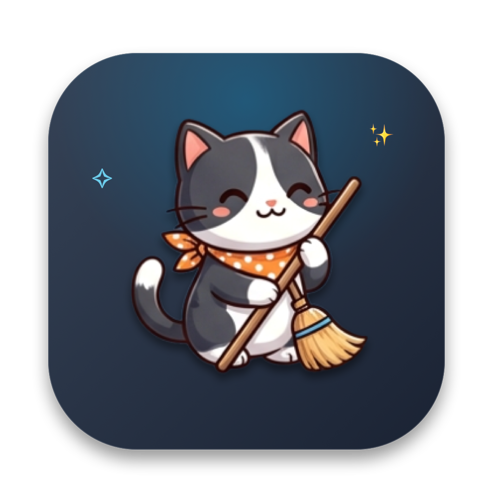

# 🐾 PawsLock

<p align="center">
  
</p>

<p align="center">
  <strong>A cute, minimalist macOS utility to lock your keyboard while cleaning your MacBook.</strong><br>
  No full-screen blackouts, no accidental typing, zero telemetry.
</p>

<p align="center">
  <a href="https://github.com/djakamiriandi/PawsLock/releases/latest"></a>
</p>

<p align="center">
  <a href="https://github.com/djakamiriandi/PawsLock/releases"></a>
  
  
  
  <a href="LICENSE"></a>
  
</p>

---

## ⚡ Quick Download & Install (For Everyone)

> [!IMPORTANT]
> **New to GitHub / Bukan Programmer?**  
> **JANGAN** klik tombol hijau `Code -> Download ZIP` di atas! Itu hanya berisi kode sumber mentah (*source code*) dan tidak bisa langsung dijalankan.  
>  
> 👉 **Unduh aplikasi siap pakai langsung di sini:**  
> 🔗 [**Download PawsLock-v1.1.0.dmg (Klik di sini)**](https://github.com/djakamiriandi/PawsLock/releases/latest)

### 📲 3 Langkah Mudah Memasang di Mac:

1. **Unduh Installer**: Klik tautan download di atas untuk mendapatkan file `PawsLock-v1.1.0.dmg`.
2. **Pasang ke Mac**: Klik dua kali file `.dmg` yang sudah diunduh, lalu **tarik (*drag & drop*) icon PawsLock ke folder Applications**.
3. **Buka Aplikasi**:
   * *Jika muncul dialog keamanan Apple ("App is from an unidentified developer")*:  
     Cukup **Klik Kanan (atau Control + Klik)** pada icon PawsLock di folder Applications → pilih **Open** → klik **Open**. *(Hanya perlu dilakukan 1 kali pada pembukaan pertama)*.
   * *Beri Izin Aksesibilitas*: Masuk ke **System Settings → Privacy & Security → Accessibility** dan aktifkan centang untuk **PawsLock**.

---

## 💡 The Problem & The PawsLock Solution

Ever tried wiping dust, crumbs, or fingerprints off your MacBook keyboard, only to accidentally open 10 browser tabs, trigger emergency shortcuts, or send garbled messages to your team?

Most existing keyboard cleaners force a completely black, full-screen takeover that prevents you from seeing your screen or using your trackpad.

**PawsLock** takes a modern, non-intrusive approach:

| Feature | Traditional Lockers (e.g. KeyboardCleanTool, ShinyMac) | PawsLock 🐾 |
| :--- | :--- | :--- |
| **Window Style** | Fullscreen black screen that blocks everything | **Compact, floating dark frosted-glass HUD** |
| **Screen Usability** | Screen is completely covered | **Screen stays 100% visible** (read tutorials or notes) |
| **Trackpad / Mouse** | Often locked or hard to navigate | **Trackpad remains active** for smooth slide-to-unlock |
| **Unlock Mechanism** | Single shortcut or wait for timeout | **Dual `⌘` hold (3s)** OR **Slide to Unlock** |
| **Mascot & Charm** | Plain technical dialog | **Adorable Tuxedo Cat** with animated cleaning dust ✨ |
| **Telemetry & Privacy** | Varies | **100% Offline, Zero Telemetry, Open Source** |

---

## ✨ Features

- 🐱 **Adorable Tuxedo Cat Companion**:
  - **Before Cleaning (Idle)**: The cat stays calm and completely static.
  - **During Cleaning (Active)**: Subtle animated dust clouds and sparkles (`✧`, `✨`) drift from the broom bristles, giving satisfying visual feedback.
- 🪟 **Compact Floating Glass HUD**:
  - Non-intrusive 380×440 floating card with macOS native frosted glass, subtle ambient blue aura, and smooth spring transitions.
- 🔒 **Total Physical Keyboard Lock**:
  - Low-level macOS `CGEventTap` intercepts and safely discards physical `keyDown` and `keyUp` events before they reach any running application.
- 🔓 **Two Safe Unlock Options**:
  1. **Dual Command Hold**: Press and hold both **Left `⌘`** (keycode 55) and **Right `⌘`** (keycode 54) keys simultaneously for **3 seconds**. A circular progress ring displays real-time countdown progress.
  2. **Slide to Unlock**: Drag the smooth paw knob past 70% with your trackpad or mouse as an immediate mouse-based fallback.
- 🎨 **Native Apple Human Interface Design**:
  - Includes an official multi-resolution squircle app icon (`AppIcon.icns`) tailored for macOS Ventura, Sonoma, and Sequoia.
- ⚡ **Lightweight & Battery Friendly**:
  - Written in 100% pure Swift & SwiftUI. Zero third-party dependencies, zero background daemon baggage, and near-zero idle CPU usage.

---

## 🛠️ System Requirements

- **Operating System**: macOS 13.0 (Ventura), macOS 14.0 (Sonoma), macOS 15.0 (Sequoia), or later.
- **Hardware**: Apple Silicon (M1/M2/M3/M4/Pro/Max) or Intel 64-bit Mac.
- **Permissions**: macOS **Accessibility** permission (required by Apple for intercepting hardware keyboard events).

---

## 💻 Building from Source (For Developers)

If you are a developer and want to compile the project yourself:

```bash
# 1. Clone this repository
git clone https://github.com/djakamiriandi/PawsLock.git
cd PawsLock

# 2. Compile and package the app bundle
chmod +x build.sh
./build.sh

# 3. Launch PawsLock
open PawsLock.app
```

---

## 🔐 macOS Accessibility Permission Setup

Because macOS protects keyboard events for security, any tool that temporarily suppresses keys requires **Accessibility** permission:

1. On first launch, PawsLock will open a permission dialog or take you to **System Settings**.
2. Navigate to **System Settings** → **Privacy & Security** → **Accessibility**.
3. Toggle the switch next to **PawsLock** to **ON**.
4. PawsLock will automatically detect the permission and unlock full keyboard protection.

> [!TIP]
> **Troubleshooting Permission Toggle:**  
> If you ever re-install or replace the app bundle and macOS does not detect the new permission, reset the permission entry via Terminal:
> ```bash
> tccutil reset Accessibility com.pawslock.app
> ```

---

## 🛡️ Security & Privacy Guarantee

- **No Keylogging**: Keystrokes are intercepted in memory via macOS CoreGraphics `CGEventTap` only while cleaning mode is active. Key events are swallowed immediately; no keys are ever recorded, analyzed, or stored.
- **Zero Network Activity**: PawsLock has no network permissions, no embedded analytics, no crash reporters, and zero tracking SDKs. You can verify this using tools like Little Snitch or LuLu.
- **100% Open Source**: Every single line of code is available right here in this repository.

---

## 📁 Repository Structure

```text
PawsLock/
├── .github/
│   ├── workflows/ci.yml       # GitHub Actions automated build workflow
│   └── ISSUE_TEMPLATE/        # Bug report & feature request templates
├── Package.swift              # Swift Package Manager definition
├── Info.plist                 # macOS application bundle metadata & icon reference
├── build.sh                   # Automated release build & codesign script
├── LICENSE                    # MIT License
├── README.md                  # Comprehensive project documentation
├── CONTRIBUTING.md            # Guidelines for open-source contributors
├── CHANGELOG.md               # Version release history
├── SECURITY.md                # Security policy & disclosure information
├── Resources/
│   ├── AppIcon.icns           # Multi-resolution macOS squircle icon (16x16 to 1024x1024)
│   ├── app_icon.png           # Master 1024x1024 icon graphic
│   └── cat_sweeping.png       # Tuxedo cat mascot illustration (transparent PNG)
└── Sources/
    └── PawsLock/
        ├── main.swift                       # Application entry point
        ├── App/
        │   └── AppDelegate.swift            # Window management & lifecycle
        ├── Controllers/
        │   └── OverlayWindowController.swift # Non-intrusive floating HUD controller
        ├── Managers/
        │   ├── AccessibilityManager.swift   # macOS TCC accessibility check
        │   └── EventTapManager.swift        # Low-level CGEventTap keyboard suppression
        ├── Models/
        │   └── AppState.swift               # Reactive application state
        └── Views/
            ├── PawsLockMainView.swift       # Main HUD with spring animation transition
            ├── SweepingCatView.swift        # Mascot view (static idle, gentle lock sweep)
            ├── DustCleaningParticlesView.swift # Drifting dust & sparkles particle emitter
            ├── SpeechBubbleView.swift       # Cheerful dynamic speech bubble
            ├── DualCmdKeysView.swift        # Command keycaps & 3s countdown indicator
            └── SlideToUnlockBarView.swift   # Smooth draggable trackpad unlock slider
```

---

## ❓ Frequently Asked Questions (FAQ)

<details>
<summary><strong>Why does PawsLock keep mouse/trackpad movement enabled?</strong></summary>

Many users want to clean their keyboard while having a document, cleaning guide, or video open. Keeping mouse input active ensures you always have a guaranteed fallback to unlock the app via the **Slide to Unlock** bar, even if you are using an external keyboard with unusual key mappings.
</details>

<details>
<summary><strong>Does PawsLock support external USB / Bluetooth keyboards?</strong></summary>

Yes! The `CGEventTap` is hooked at the system level (`.cghidEventTap`), which intercepts keyboard input from both your built-in MacBook keyboard and any connected external keyboards.
</details>

<details>
<summary><strong>What happens if one of my Command keys is broken?</strong></summary>

You can simply drag the **"Slide to Unlock"** bar at the bottom using your trackpad or mouse to instantly restore keyboard input.
</details>

---

## 🤝 Contributing

Contributions are warmly welcomed! Please check out [`CONTRIBUTING.md`](CONTRIBUTING.md) to get started.

---

## 📜 License

Distributed under the **MIT License**. See [`LICENSE`](LICENSE) for details.

<p align="center">
  Made with 🐾 for clean Mac keyboards everywhere.
</p>
